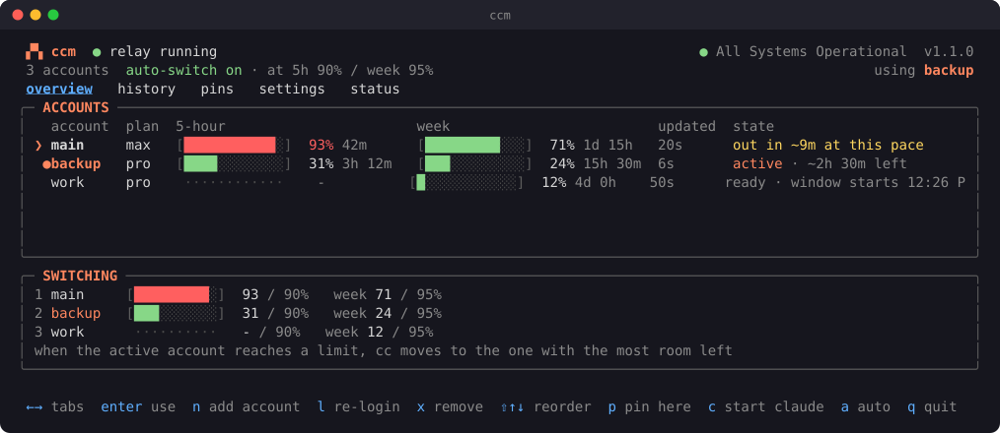
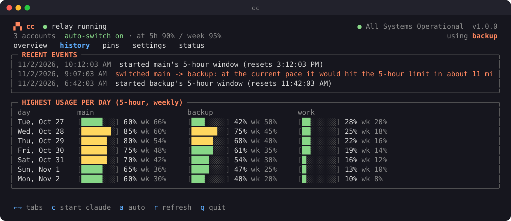
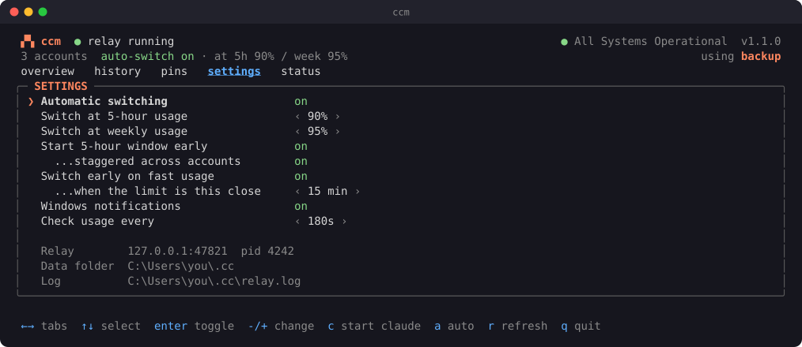

<div align="center">

# CC-multi-account

### Never hit a Claude Code limit mid-task again.

`cc` runs Claude Code across all your Claude subscriptions and moves your session to
another account **the moment one runs low**: same conversation, no restart, no re-login.

[](#requirements)
[](https://nodejs.org)
[](package.json)
[](LICENSE)



</div>

---

## You know the feeling

You're deep in a refactor. Claude Code is mid-edit. Then:

> *You've reached your usage limit. Resets at 6:20 PM.*

You switch accounts by hand, start a new session, and re-explain everything.
Or you use an account switcher, and every few hours it asks you to **log in again**.

**`cc` fixes both.**

## What you get

🔄 **Switches mid-session, automatically.** When an account reaches your
threshold, the next message goes to the account with the most room left.
Your conversation carries on as if nothing happened.

🛟 **Catches the limit you didn't see coming.** If Anthropic refuses a message
because the account just ran out, cc resends **that same message** on another
account. Claude Code never sees the error.

📈 **Switches before you run out.** cc watches how fast you're burning
through the 5-hour window. If at this pace you'd hit the wall within 15
minutes, it moves you now.

🔐 **Never logs you out.** Each account is signed in once, just for cc, and
only cc refreshes it. No other tool can invalidate it. Logins are encrypted
with Windows DPAPI.

⏱️ **Gets your next 5-hour window started sooner.** The window only starts
counting at your first message. cc starts a new one the second the last one
ends, so it resets hours earlier. Or stagger them across accounts so one is
always nearly fresh.

📌 **Pin a project to an account.** Client work on the work account, side
projects on your own: per folder, automatically.

🖥️ **A dashboard that shows everything.** Usage bars, reset times, burn
rate, switch history, daily peaks, Anthropic's live status. One command: `cc`.

🧩 **Nothing else changes.** Your skills, plugins, MCP servers, hooks, memory
and history work exactly as before. VS Code and the terminal both work.
The Claude Desktop app keeps its own login, untouched.

🪶 **Tiny.** Plain Node.js, zero dependencies, about 35 kB.

## Quick start

```powershell
git clone https://github.com/Multitelo/CC-multi-account.git
cd CC-multi-account
npm install -g .
```

```powershell
cc              # open the dashboard, press n to add each account
cc install      # connect VS Code, the status line and start-at-sign-in
```

Reload VS Code (*Developer: Reload Window*) and you're done. In a terminal,
use `cc start` instead of `claude`.

> When you add an account, a browser window opens. **Check it shows the
> account you mean before you approve.** If it picks the wrong one, use a
> private window.

## See it

<details open>
<summary><b>History</b>: every switch, and why</summary>
<br>

</details>

<details>
<summary><b>Settings</b>: tune it from the dashboard</summary>
<br>

</details>

And in every terminal session, the status line:

```
cc backup | 5h 31% | wk 24%
```

## Why other switchers log you out (and this doesn't)

A Claude login carries a refresh token that **works only once**: every refresh
replaces it. Most switchers work by copying login files in and out of
`~\.claude`. Then the switcher and Claude Code both refresh the same login,
and whichever goes second is left holding a dead token. You're logged out.

`cc` takes a different route. Claude Code talks to a small relay on your own
machine, and the relay attaches the right account to each request:

```
 Claude Code  (VS Code, or `cc start` in a terminal)
      │   ANTHROPIC_BASE_URL = http://127.0.0.1:47821
      ▼
 cc relay  ── local only; owns each account's login; picks the account per request
      │
      ▼
 api.anthropic.com
```

| | File-swapping switchers | **cc** |
|---|:---:|:---:|
| Switch in the middle of a session | ⚠️ on the next refresh, sometimes | ✅ on the next message |
| Retry the message that hit the limit | ❌ | ✅ |
| Switch early based on burn rate | rare | ✅ |
| Random "please log in again" | ⚠️ common | ✅ no: logins aren't shared |
| Leaves the Desktop app's login alone | ❌ | ✅ |
| Starts 5-hour windows early / staggered | some | ✅ |
| Per-folder account pins | rare | ✅ |
| Logins encrypted at rest | varies | ✅ Windows DPAPI |

## Requirements

- Windows 10 or 11
- [Node.js](https://nodejs.org) 18 or newer
- [Claude Code](https://docs.claude.com/en/docs/claude-code) installed (`claude` works in a terminal)
- Two or more Claude accounts with Claude Code access (Pro, Max, Team or Enterprise)

> **Please read.** This project is not affiliated with Anthropic. Using several
> personal subscriptions to get past usage limits may not be allowed under
> Anthropic's consumer terms. Check them and decide for yourself before
> relying on it.

---

## Reference

### The dashboard

Run `cc`.

| Tab | Shows | Keys |
|---|---|---|
| overview | 5-hour and weekly usage, reset times, burn rate and state per account; the switching order | **enter** switch to it · **n** add account · **l** sign in again · **x** remove · **shift+↑↓** reorder · **p** pin the current folder |
| history | switches, limits, sign-ins, window starts; highest usage per day | |
| pins | pinned folders | **p** pin a folder · **d** unpin |
| settings | auto-switch, thresholds, window start and staggering, early switching, notifications, check interval | **enter** toggle · **- / +** change |
| status | Anthropic's live status (status.claude.com) and open incidents | |

Everywhere: **←→** tabs, **a** auto-switch on/off, **r** re-check usage,
**c** start Claude Code here, **q** quit.

### Commands

| Command | What it does |
|---|---|
| `cc` | Open the dashboard |
| `cc start [claude args]` | Start Claude Code through cc (`cc start --resume`; flags also work directly: `cc --resume`) |
| `cc start --account backup` | One session on one account only |
| `cc login <name>` | Sign an account in (or in again) |
| `cc remove <name> --yes` | Forget an account |
| `cc status [--refresh]` | Usage and state of every account |
| `cc use <name>` | Switch now |
| `cc auto on\|off` | Automatic switching |
| `cc threshold <5h> [week]` | When to switch, in percent (`cc threshold 90 97`) |
| `cc order <a> <b> ...` | Priority order |
| `cc pin [account] [folder]` | Always use one account in a folder |
| `cc unpin [folder]` / `cc pins` | Remove a pin / list pins |
| `cc log [-n 50]` / `cc log --usage` | Switch history / highest usage per day |
| `cc notify on\|off` | Windows notifications |
| `cc doctor` | Check everything |
| `cc install` / `cc uninstall` | Connect to or disconnect from VS Code, the status line and sign-in |
| `cc serve` / `cc stop` / `cc restart` | Control the relay |

### How switching decides

On every request, the active account counts as **low** if:

1. its 5-hour usage ≥ the 5-hour threshold, or weekly usage ≥ the weekly threshold, or
2. at the pace of the last 30 minutes it would hit 100% within the early-switch
   time (15 min), before its window resets.

When it's low, cc moves to the account with the most room left, notifies you
and logs why. If every account is low, cc keeps going on whatever still works.
If a request is refused for the limit, it's retried on each other account
before the error reaches Claude Code. Pinned folders and `--account` sessions
never switch.

Usage comes from the rate-limit headers on every response (live) and from
Anthropic's usage endpoint, checked every 3 minutes for every account.

### Settings

In the dashboard's settings tab, or `%USERPROFILE%\.cc\config.json` (picked up within 30 seconds).

| Key | Default | Meaning |
|---|---|---|
| `auto` | `true` | Switch automatically |
| `threshold5h` | `95` | Switch at this 5-hour usage % |
| `threshold7d` | `98` | Switch at this weekly usage % |
| `burnAware` | `true` | Switch early when usage is rising fast |
| `burnMinutes` | `15` | ...if at the current pace the limit is this many minutes away |
| `startWindow` | `true` | Start a new 5-hour window as soon as the last one ends |
| `staggerWindows` | `false` | Space accounts' windows 5h ÷ accounts apart instead |
| `notify` | `true` | Windows notifications |
| `pollSeconds` | `180` | How often to check every account's usage |
| `port` | `47821` | Relay port on 127.0.0.1 |

### Good to know

- **VS Code needs the relay running.** It starts at Windows sign-in and restarts
  itself if it crashes. `cc doctor` tells you if it's down. In a terminal,
  `cc start` starts it on demand and falls back to your normal login if it can't.
- **"Total cost" in the VS Code panel is only an estimate.** Claude Code shows it
  because it was started with a key instead of a claude.ai login. Nothing is
  charged: requests use your subscription logins.
- **claude.ai connectors are off in cc sessions**, because the login comes from cc.
  Local MCP servers still work.
- **After a switch, the conversation continues on the other account.** Only mix
  accounts whose data you're allowed to share.
- **Window starts need the PC awake.** If it's asleep when a window ends, the next
  one starts when it wakes.

### Security

- The relay listens on **127.0.0.1 only** and requires a random local key.
- Logins live in `%USERPROFILE%\.cc\accounts\*.dat`, encrypted with Windows DPAPI
  (CurrentUser), and are sent only to Anthropic (`api.anthropic.com`,
  `platform.claude.com`). The only other host contacted is `status.claude.com`.
- During `cc login`, Claude Code writes a temporary plain-text copy of the login;
  cc deletes it right after encrypting it.
- `cc install` backs up every settings file it changes to `%USERPROFILE%\.cc\backups\`.
- The local key in VS Code's settings only unlocks the relay on 127.0.0.1. It isn't
  an Anthropic credential.

### Files

| Path | Contents |
|---|---|
| `%USERPROFILE%\.cc\config.json` | Settings, pins, account emails (no logins) |
| `%USERPROFILE%\.cc\accounts\*.dat` | Encrypted logins |
| `%USERPROFILE%\.cc\state.json` | Live usage (used by the status line) |
| `%USERPROFILE%\.cc\history.jsonl` | Switch and usage history |
| `%USERPROFILE%\.cc\relay.log` | Relay log (`CC_DEBUG=1` logs every request) |

### Troubleshooting

| Problem | Fix |
|---|---|
| VS Code Claude can't connect | `cc doctor`, then `cc restart` |
| An account shows "login broken" | Select it in the dashboard and press **l**, or `cc login <name>` |
| The browser signs in the wrong account | Cancel, use a private window signed into the right account, try again |
| Usage numbers look stale | Press **r** in the dashboard, or `cc status --refresh` |
| Anything else | `%USERPROFILE%\.cc\relay.log` |

### Uninstall

```powershell
cc uninstall      # disconnect VS Code, status line, start at sign-in
cc stop           # stop the relay
npm uninstall -g cc-multi-account
Remove-Item -Recurse "$env:USERPROFILE\.cc"   # deletes saved logins and history
```

Without npm, install with `node cc.js install shim` (puts `cc` in
`%USERPROFILE%\.local\bin`, which must be on your PATH).

## Contributing

Issues and pull requests are welcome.

```powershell
npm test
```

The tests run the relay against a fake Anthropic server in a throwaway folder.
They never touch your real accounts.

| File | Role |
|---|---|
| `cc.js` | Command line and launcher |
| `lib/relay.js` | Relay: choosing accounts, forwarding, refresh, retries, window starts, burn rate |
| `lib/tui.js` | Dashboard |
| `lib/anthropic.js` | Token refresh, usage, profile, 1-token message |
| `lib/store.js` | Config, state, DPAPI-encrypted logins |
| `lib/install.js` | VS Code, status line, sign-in start, terminal shim |
| `lib/sessions.js` | Folder pins (session → project folder) |
| `lib/history.js` | History and log |
| `lib/notify.js` | Windows notifications |

## License

[MIT](LICENSE). If cc saves you from a limit, a ⭐ helps others find it.
